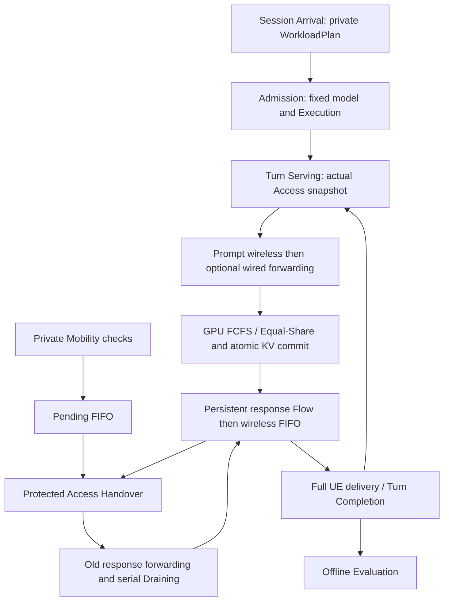

# S0–S3 reproduction and architecture

S0, S1, S2, S3-A Mobility, S3-B Handover and S3-C Integration are complete.
S3 freezes after the 2026-11-12 closing round. S4 KV Live Migration is not yet
designed or implemented; S5 Joint Re-placement has not started.

Python 3.10+, standard library. Run from repository root:

```powershell
python -m unittest discover -s tests -v
python scripts/verify_s2c.py
python scripts/verify_s3b.py
python scripts/verify_s3c.py
```

Stage verifiers include exact Oracle comparisons, shared Serving and earlier
regressions. Writers create fresh output directories themselves. Tests use
isolated system temporary directories; no pre-existing `runs/` or prior result
is required. Fixed regressions and random validation both run in full unittest.

## Authoritative inputs

`configs/` holds synthetic experiment inputs. `tests/` includes the independent
rational vertex Oracle (`max_min_oracle.py`) and mathematical fixtures in Python.
`docs/s1d_verification.json` is a REQUIRED historical regression fixture read by
`scripts/verify_s1e.py`; its stored old run paths are provenance strings, never
directories that the verifier opens. Keep its contents and path stable.
All other stage verification JSON/logs are optional local history.

The current model is indexed by [model_spec/README.md](model_spec/README.md).
The 2026-11-07 original E revision defines the weighted objective and supersedes
the old E latency-only objective. The 2026-11-06 A–D bytes remain unchanged;
explicit user overrides exclude priorities, preemption, old model selectors and
per-Turn Access plans. Historical statements do not override the current index.

## Canonical modules and ownership

- `core/entities.py`: unique ModelSpec, SessionState, TurnState, EdgeState,
  immutable OutputToken. Model structure derives KV Byte/token.
- `core/runtime.py`: Turn transitions, explicit token_id delivery, Session end.
- `core/workload.py`: private future workload; `core/observation.py`: frozen
  whitelist values only, without Driver/Config/future-event references.
- `resources/`: unique GPU Equal-Share, FCFS Turn slots, typed compute and KV.
- `network/`: static Area/DirectedLink/FixedPath/NetworkTopology; Flow lifecycle,
  exact Fraction Byte accounting, default unweighted Max-Min progressive filling;
  WirelessRuntime uses the same Byte kernel with independent Session/direction rates.
- `simulation/events.py`: single event queue; `simulation/serving.py`: formal
  multi-Session/Turn executor; `simulation/s0.py`: retained lifecycle/safety fixture.
- `simulation/mobility.py`: private Markov/Pending process;
  `simulation/handover.py`: actual Access changes and protected serial Draining;
  `simulation/evaluation.py`: offline completion, censoring and raw overhead.
- `simulation/migration_guard.py`: one fixed Source/Target admission lease per
  Session; no KV Copy, Shadow, STOP or Cutover implementation.
- `demos/` and `replacement.cli`: implemented CLI entry points, no root forwarding
  modules. All demo inputs are supplied from `configs/`.

GPU continuous Prefill/Decode retains one Turn slot; KVBlocked releases it and
keeps completed pending work. Context/KV commits are atomic and cumulative.
Network reallocation first settles old Byte, then changes activity/rates and
invalidates forecasts. One response Flow per Turn/path receives actual committed
Tokens. Full wired Token arrival precedes wireless FIFO. Only complete UE delivery
ends the Turn; the next Turn submits at the same time. Full E2E is receive minus
submit; incomplete all-planned means are null.

Topology-enabled Serving checks permitted Access/Execution membership, deployment
and both directed paths. Frozen Token origins never follow later position fields.
The default MaxMinAllocator accounts for all links on frozen flows' paths and
recovers residual capacity. DisjointPathAllocator is an explicit historical guard.
Wireless remains outside wired sharing. Units: eq-work/s, bit/s, Byte, seconds.



The Access Edge terminates UE radio traffic; the Execution Edge computes and
owns the unique authoritative KV. Handover changes Access and resumes response
delivery through real forwarding Flows. Execution and KV stay fixed throughout
S3. Future S4 execution migration is a separate mechanism requiring real copying
and safe Cutover. A plan or admission lease cannot perform that change.

## Scripts and artifacts

`verify_s1e.py`, `verify_s2b.py`, `verify_s2c.py` are reproducible acceptance
drivers. `audit_s2c.py` runs the independent test-only Oracle; `stress_s2b.py`
executes deterministic conservation scenarios. Keep `tests/` when running these
scripts: the Oracle driver imports test utilities by design.

Simulation results include Flow/Link rate and utilization traces, G/Y Byte
progress, Token/Turn/Session records, GPU/KV records and offline config copies.
These are outputs under `runs/`; they are not test inputs or publishable source.

S3-A planned-only Markov/Pending and opt-in S3-B actual Handover/Draining are
described below; S3-C integration is complete. S4 migration/Shadow/Cutover and
later policies are outside the implemented system.
No performance claim for real hardware or model weights is made.

## S3-A Mobility Workload and Pending State

`simulation/mobility.py` owns frozen PendingMove and per-Session MobilitySessionState
(planned Access, deque, checks/changes/depth/cancellation counters). Actual Access
is read only from core SessionState. No second Session/Flow/KV entity is introduced.
`mobility` requires topology and finite `observation_end_s` (T_obs); all registered
Edges need a probability row. Exact decimal Fraction sums must equal 1. Every
positive non-self edge needs adjacency and its directed path; every transitive
reachable Access needs allowed membership and both serving directions to fixed
Execution. Checks start only after actual arrival, at arrival+n*interval, not at
Turn completion. Intervals below the existing 1e-12s queue resolution are rejected.

Draw format is compact UTF-8 JSON `[seed,session_id,check_index]`; SHA-256 first
8 bytes in big-endian order divided by 2**64. Sorted Edge IDs and previous planned
row determine the next plan. Only one next check is scheduled. Events contain only
already-experienced checks and edges. Pending preserves all adjacent edges FIFO;
self transitions do not enqueue. Planned-only mode does not consume Pending;
opt-in actual Handover consumes it under the S3-B protection rules.

GPU20/KV25/Serving30/transport50 precede mobility80 and checkpoint90. Mobility-only
planning does not change rates/activity or inspect partial work; resources keep
lazy exact settlement at original service events/checkpoints, preserving all core
traces. S3-B settles affected resources before actual Handover changes. Every
Serving Session end path notifies MobilityRuntime; logical invalidation skips old
checks before the clock advances. End clears Pending with cancellation counters,
retaining history. KVBlocked alone does not end the Session. max_pending_depth is
the maximum single Session FIFO depth, not the sum of simultaneous queues.

Mobility run() uses advance_to(T_obs); boundary checks are included unless Session
termination at that instant wins. Unfinished Sessions and Pending remain real.
T_obs, future turns, probabilities and random seed are absent from OnlineObservation.
Without mobility, existing run(), result schema and resource behavior are unchanged.
Runtime stage labels remain S1-D without topology, S2-C with topology,
S3-A with planned-only mobility and S3-B with enabled actual Handover;
S3-C names the integration acceptance stage.

S3-A results append only `mobility={summary,sessions,events}`; CLI --out additionally
writes mobility.json. Aggregate summary fields: mobility_checks, planned_access_changes,
pending_moves_added/cancelled, max_pending_depth, pending_moves_at_observation_end.
Per-Session rows distinguish initial/planned/actual Access and fixed Execution.
No Actual Handover completion record, new objective function or optimization exists.
The current objective is weighted latency and Overhead; current execution reports
raw components without inventing weights or implementing an optimization policy.

```powershell
python -m unittest discover -s tests -p test_mobility.py -v
python scripts/verify_s3a.py
```

The verifier runs full tests and both S1/S2 verifiers, CLI smoke on the existing
six-Edge topology plus required paths, and exact core-result comparison against
mobility-disabled Serving at the same T_obs. All outputs use new runs/s3a_* paths.


## Poisson workload and opt-in actual Handover (2026-11-11)

`core/workload_generation.py` generates the existing immutable WorkloadPlan with
separate SHA-256-derived stdlib Random streams for arrivals, initial Edge, Turn
count, Input and Output. First arrival is exponential. Integer bounds include
both endpoints. Arrival horizon bounds only creation, not Session lifetime.
At clock resolution boundaries in-window arrivals are retained, rounded and
clamped to the first/final legal 1e-12s tick; same-tick arrivals keep stable IDs.
Selected fixed model must exist, output max must equal its output_limit_per_turn,
and initial Access=Execution is uniformly drawn from sorted deployed Edges.
No context-total admission filter, cropping, retries or DurationSampler exists.

Config: `workload.mode` defaults to static; poisson requires arrival_rate_per_s,
arrival_horizon_s, model_id and turn_count/input_tokens/output_tokens min/max.
It cannot also supply static sessions. `observation_end_s` is finite and at least
the arrival horizon. It is a global cutoff, also without Mobility; events at
cutoff execute through checkpoint90, later events never execute. Zero arrivals
end normally, with undefined means/ratios represented by null.

`ServingSimulator(config, workload_plan=plan)` accepts a validated shared frozen
Poisson plan, without sampling a new one. workload_to_dict/from_dict and
workload_hash support complete offline replay. The Driver owns all future data;
results.workload and CLI workload.json are explicitly offline artifacts only.
Poisson reporting separates completed/legally-terminated/unfinished Sessions,
planned context exceedances, actual ContextLimit/KVBlocked ratios and actual or
censored lifetimes. Mean Full-Turn E2E retains the complete planned denominator;
ContextLimit can make it null even when every Session has legally ended.

Completion now checks the private target before output cap: target==cap ends
normally; a static target above cap still ends with OutputLengthLimit. The
existing atomic Session Context and physical KV checks remain authoritative.

`mobility.min_inter_move_interval_s` defaults to0. A Markov proposal inside the
interval after the last accepted plan change is rejected without updating planned
Access or adding Pending; checks/RNG indexing continue. Optional counters separate
proposals, rejections and accepted changes. Unconfigured S3-A outputs are unchanged.

`handover.enabled=true` is an explicit opt-in requiring mobility, stage S3-B.
Disabled/absent retains original S3-A planned-only mode. Controller is in
simulation/handover.py. It protects the entire actually-started Prompt through
Execution arrival and any already-started wireless Token. Pending pauses starting
the next wireless Token. Actual changes consume the first adjacent FIFO edge,
respect min actual intervals, allow at most one change per timestamp, and never
change Execution/KV or frozen OutputToken provenance.

An actual switch freezes undelivered old Tokens and closes their old original
response producer without canceling Byte progress. All frozen Tokens first finish
the original wired stage to old Access. A real FlowType.HANDOVER on old->new fixed
path then competes for Max-Min capacity. Each complete forwarded Token can enter
wireless immediately, without waiting for the whole forwarding batch. New generated
Tokens buffer until the old set is fully delivered. Draining prevents another
actual switch. One Turn never holds multiple simultaneous wired response shares.
GPU generation continues under existing constraints. Turn submit remains zero Idle
at30; new Prompt starts85 after actual Handover80, using the latest actual Access.
Completed/incomplete draining durations are reported distinctly.

The new ServingObservation extends frozen current-only DTOs with created transfer
Byte/rate/path/status and current Handover/protection/Pending-depth/guard values.
It contains no Driver, plan, RNG or event queue. Known partial GPU service and
Byte progress may be projected to the current clock (bits/8) without resource or
trace mutation. Legacy observation DTOs remain unchanged. No policy algorithm or
objective function is introduced.

simulation/migration_guard.py provides immutable per-Session MigrationLease and
MigrationAdmissionGuard.try_begin/complete/fail. Duplicate active requests return
None and increment rejection count. Source/Target are fixed. Stale/foreign leases
cannot release another operation. There is no cancel/retarget/replay queue.
Complete requires the future S4 caller to establish real completion/Cutover; the
Guard itself performs no Copy or Cutover. Session end releases a remaining lease
with session_end failure. Access Handover does not check or acquire this lock.

For real Poisson sizes the same transport kernel uses compact_history=True:
terminal records leave active scans but remain in immutable result history and
ID uniqueness checks. Transactions copy mutable records/boundary lists while
sharing frozen Flow/Path/TokenBoundary/Fraction values. Unchanged future exact
forecasts retain their valid queued event; real changes allocate monotonically
increasing versions, including across rollback. Physical Byte equations,
Max-Min/independent wireless rates and capacity checks are unchanged. Historical
static/S3-A retains the original bookkeeping/trace path. Compact-mode allocation
traces show current records; diagnostic event_version values can differ from
noncompact replay, while physical bytes/times/notices are tested equal.

```powershell
python -m unittest discover -s tests -v
python scripts/verify_s1e.py
python scripts/verify_s2c.py
python scripts/verify_s3a.py
python scripts/verify_workload.py
```

`configs/poisson_session_smoke.json` uses temporary lambda=.05, arrivals600s,
Tobs900s, J2..5, I40..120, O80..200, native model context1200, min moves60s.
All are functional-test values, not paper-calibrated hardware parameters.
The explicit config max_events is a finite executor safety guard (default100000),
not a Session admission cap or model constraint. All generated artifacts stay
under runs/. Current publication lists are maintained separately per user review;
do not assume a previous-stage package includes newly introduced dependencies.

## S3-C integration acceptance (2026-11-12)

`python scripts/verify_s3c.py --out runs/a_new_s3c_directory` runs S3-C directed
tests, the existing S3-A chain (full unittest, S2-C Oracle and S1 regressions),
S3-B's normal/incomplete Poisson integration, and the deterministic three-Session
`configs/s3c_hand_shared.json`. It audits raw GPU service integrals, structural KV
commit/release deltas, prior-rate Byte progression, frozen Token provenance, UE
completion and censoring. Small shared allocations use the independent rational
vertex Oracle. No second simulator or resource ledger is introduced.

Actual-Handover mode defers new wireless Token starts to phase85, after same-clock
due mobility80, including when the move was not yet Pending at UE completion.
Already-started Tokens remain protected. All configured finite Serving cutoffs
own a terminal phase90 checkpoint, including direct step() callers; run() and
advance_to() reuse it. No-horizon historical execution is unchanged.

Enabled Handover results/CLI additionally include offline `evaluation` /
`evaluation.json`, derived from existing records by simulation/evaluation.py.
It records unsubmitted and submitted unfinished counts, current waiting reasons,
right-censored E2E lower bounds only for still-live Turns (terminated failures
are separate), and actual HANDOVER Flow Y Byte independently of original response
and wireless Byte. `p95_full_turn_e2e_s` in this evaluation explicitly describes
the normally completed subset, not a full-population estimate. Original summary
fields retain canonical stage labels. G1 is `mean_full_turn_e2e_s`: sum full E2E
over ALL planned legal Turns divided by their count, only after every such Turn
has genuinely completed (including legal zero-output completion). It is null for
an incomplete or empty workload. `mean_completed_full_turn_e2e_s` is a diagnostic
over the normally completed subset; it cannot replace G1. Completion rate,
unfinished/terminated/unsubmitted counts, KVBlocked, censoring durations and
reasons remain separate. `g1_metric` and scope fields identify the full-planned
semantics. GPU busy time sums active Edge seconds; running Turn time integrates
active Turn counts. Evaluation is never included in online DTOs.

The current objective from 2026-11-07 E is
`ω1·D̄_E2E + ω2·(β_mig·V_mig + β_sh·A_shadow + β_HO·V_HO)`.
Raw `V_mig` (logical KV Copy Byte), `A_shadow` (materialized Shadow Byte·s) and
`V_HO` (extra ordinary response-forwarding Byte) are independent counters. Count
actual transferred Byte, including partial transfer at cutoff and sunk overhead
before cancellation/failure; do not multiply by path hops. Unmaterialized capacity
promises are not Shadow, and E2E already includes transmission competition and
freeze waits. S3 has no real KV Copy/Shadow, so their actual values are zero.
Weights, conversion coefficients and unit scales remain unset; there is no
default weighting, normalization or aggregate score.

S4 KV Copy/Shadow/STOP/Cutover, joint Check scheduling and Re-placement policies
remain outside this stage. Actual handover_start events supply the real movement
trigger record; no policy or migration is inferred from a plan or drain completion.

## Random validation and replay

Full unittest retains deterministic regressions, boundaries and independent
Oracles and also generates 50 legal scenarios by default. Without
`SESSION_TEST_SEED`, each run creates a fresh Master Seed; setting it replays the
same scenario sequence. `SESSION_TEST_CASES` defaults to 50; use at least 500 for
extended validation. Generation uses local RNG and stable Seed derivation.
Output includes Master Seed, case count and Case Seeds; failure keeps config and
replay command and fails the test, without retrying another Seed.

```powershell
$env:SESSION_TEST_SEED = '12345' # replace with an actual reported Master Seed
$env:SESSION_TEST_CASES = '50'
python -m unittest discover -s tests -v
$env:SESSION_TEST_CASES = '500'
python -m unittest discover -s tests -v
Remove-Item Env:SESSION_TEST_SEED, Env:SESSION_TEST_CASES
```

`tests/test_random_serving.py` is discovered by unittest and reuses the local
generator/auditor in `tests/random_serving.py`. The standalone extended entry is
`python scripts/verify_random.py --seed 12345 --cases 500 --out runs/a_new_random_directory`;
optional `--case-index INDEX` replays an individual case. Failed cases retain
config, trace and reproduction information under a newly created
`runs/random_failure_*` directory; success emits Seed/case/digest records.

`python scripts/verify_clean.py --seed 12345 --cases 50 --out runs/a_new_clean_directory`
performs the clean-source acceptance using the explicit publication whitelist.
Clean-clone validation runs a separate temporary source copy without `.git`,
`runs/`, environments or caches, preserving this workspace's historical results.
Random validation checks correctness and invariants; PASS is not evidence of
algorithm performance or statistical significance. Formal policy comparisons
must share the external WorkloadPlan, mobility inputs and common Seed set.
